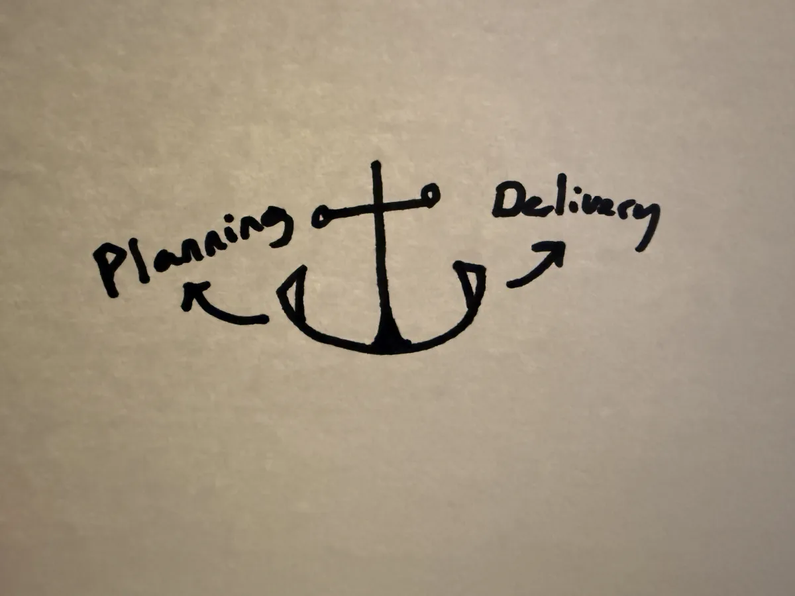
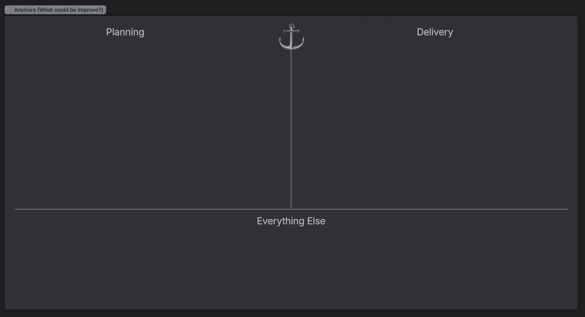

A couple of days ago I brought up the [team's constraint](/glossary#team-constraint) concept, a binary decision of team constraint being planning or delivery.

This reminded me of the the Sailboat Exercise we've done at Sodium Halogen.

The sailboat exercise essentially is talking about the wind, which is what pushes the team forward, or the anchor, which is what slows the team down.

When I think of an anchor, I think of the two hooks, the left and right. ⚓

When the anchor is thrown off the sailboat, one side of the anchor catches the floorbed of the sea and slows the vessel down.

Same is true with the team needing to focus on a single constraint, they either focus on the planning or delivery.

So now there is a [Team's Constraint Anchor](/glossary#teams-constraint-anchor): the left hook is **planning** and the right hook is **delivery**.

For a retro meeting, the intent is to not point fingers at any specific person or team (nothing disparaging). This is an opportunity to discuss openly the constraint we currently have or feel. Then we go all in on solving the team's largest constraint. We will spend the sprint on our primary goal and that single constraint.

