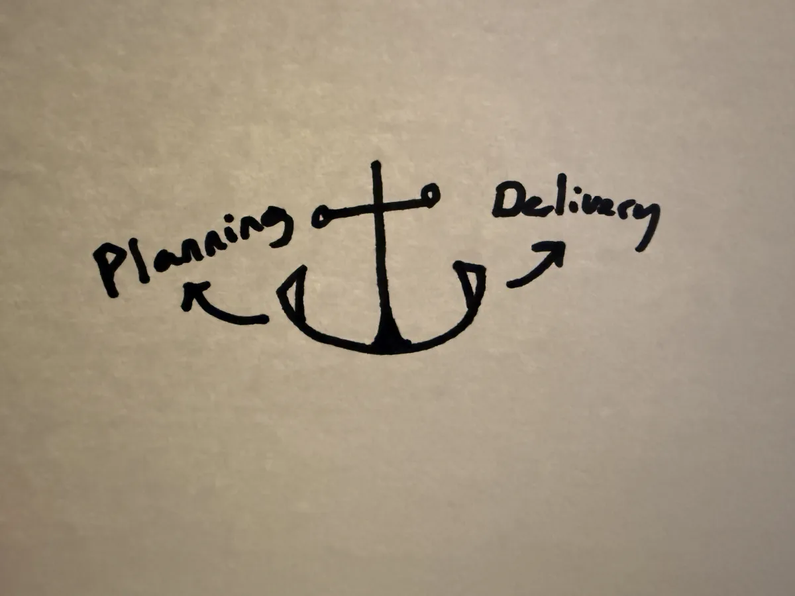
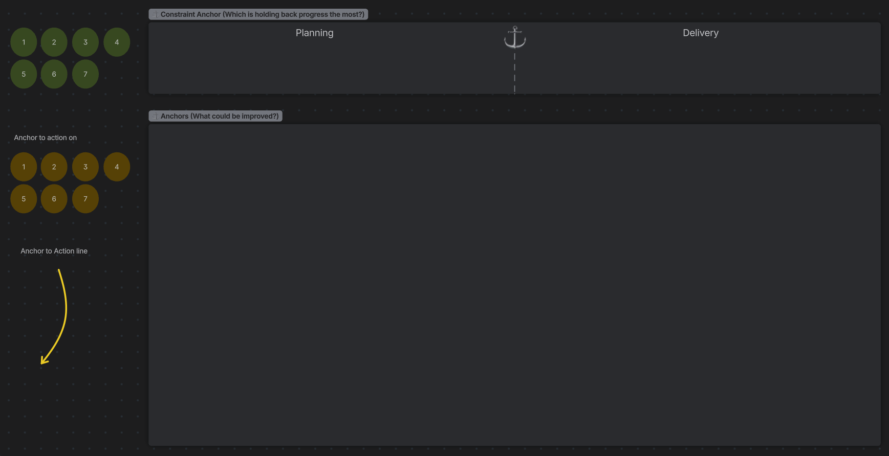

A couple of days ago, I brought up the [team's constraint](/glossary#team-constraint) concept: a binary focus between planning and delivery.

This reminded me of the Sailboat Exercise we've done at Sodium Halogen. The sailboat exercise has the team brainstorm two categories about how the team is doing: the wind, anything that pushes the team forward, and the anchor(s), anything that slows the team down.

An anchor has two hooks: the left and right. ⚓ When the anchor is thrown off the sailboat, one side of the anchor drags and catches the seabed and slows the vessel down.

Again, one hook of the anchor is causing the majority of the drag on the boat.

I call this the [Constraint Anchor](/glossary#constraint-anchor).

A business's constraint anchor is supply or demand.

A team's constraint anchor is planning or delivery. 

A visual of an anchor helps us understand that the team's progress has one constraint applying the most friction.

Anything we can do to solve this constraint (ditching anchors) reduces the drag on the team's forward momentum.

Applying this anchor to a retro meeting, the intent is not to point fingers at any specific person or team (nothing disparaging). We can't weaponize the constraint conversation. This is an opportunity to discuss openly the constraint we currently have. Then we go all in on solving the team's largest constraint. We will spend the sprint on our primary goal (feature work or tech debt) and the single largest constraint.

Here a team can vote on the constraint, and then let that guide them on what areas can be improved.

Happy sailing! ⛵
