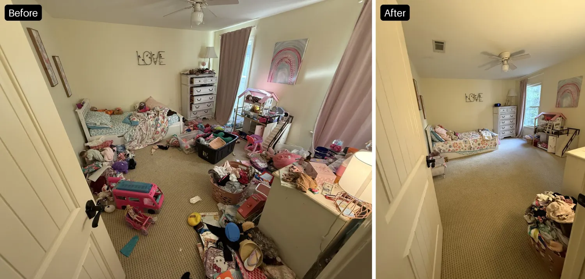

Our daughter, Mia (6 year old), cried a couple weeks ago about her room being messy.

She said, "I'm bad at cleaning my room!" I thought, "No, you're not bad at cleaning. This room is too messy for you to know where to start."

So, that got me motivated. I got toys into a couple of containers and all but 5-6 stuffies into large yard bags. Everything else was obviously trash or dirty clothes.

In the end, she was shocked when she saw her room. She's been so proud of her room ever since. An extra win has been that she's made her bed most days since.

These photos are embarrassing, but this is the [fishbowl experience](/glossary#fishbowl-experience) I can offer.

**The more she has the more she has to manage, the more we can get out, the less time she spends managing it all. She had too much to manage, and broke into tears.**

While some stuff is in a container and a bag, she's had a much easier time cleaning the room. Most of all she's played in her room more, too.

**Removing a lot is freeing up her space and time for more play.**

The point is, if we reduce down to the things that get played with most, we'll be getting [closer to zero](/focus-get-closer-to-zero).

This feels very much like the Pareto principle: 20% of the toys that get 80% of the attention.

The best thing we did for my daughter in this moment was use the principle I learned from William Donald, "Make it easy to do the right thing and hard to do the wrong thing." Removing the quantity of items that made it hard to have a clean room, gave her less to clean, making it easier to clean.

So, your turn. Give it a shot. Get some containers and bags. Take the majority of the stuff out of the kids' room, primarily the items they don't spend a lot of time with. In the end, they can ask for anything back. Only the obvious items are thrown away (fast food meal toys, dentist treasure box toys, old school crafts, etc). 

They'll be so excited to have a space they can play in and be in without the clutter in their way of their play. 

While zero is definitely easier to clean, less is still easier to clean than a lot.

Mia is happy with less, and we're happy she's happy. ❤️
